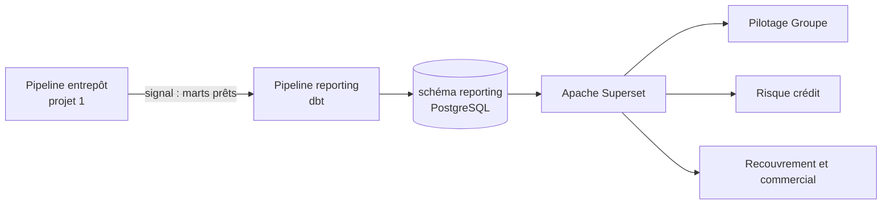

> 🔗 **Lumina Data Platform** : [1. Entrepôt](https://github.com/Isac9/lumina-data-platform-entrepot) · [2. Pilotage Superset](https://github.com/Isac9/lumina-data-platform-pilotage) · [3. Aide à la décision et gouvernance](https://github.com/Isac9/lumina-data-platform-aide-decision)

# Pilotage du portefeuille de crédit avec Apache Superset

> Projet portfolio de Data Engineering et BI : indicateurs de crédit (**PAR 30 à 120, recouvrement, provisions, roll rates**) calculés avec **dbt** sur un entrepôt **PostgreSQL**, puis restitués dans **Apache Superset** sous forme de tableaux de bord par entité et consolidés Groupe, avec sécurité par pays.
> *Suite du projet 1 (entrepôt multi-entités). Lumina Énergie est une entreprise fictive : toutes les données sont générées.*

## Ce que fait le projet

1. Chaque matin, le pipeline de l'entrepôt (projet 1) se termine et **envoie un signal** (Airflow Dataset).
2. Ce signal déclenche le **pipeline de reporting**, qui calcule avec dbt la situation de chaque prêt à chaque fin de mois (règle FIFO), puis les indicateurs.
3. **Superset** lit le schéma `reporting` et affiche 3 tableaux de bord :

| Tableau de bord | Pour qui | Contenu |
|---|---|---|
| **1. Pilotage Groupe** | Direction générale | Encours, PAR 30, PAR 90, provisions, évolution, encours par pays, **reporting institutionnel trimestriel** consolidé |
| **2. Risque crédit** | Direction des risques | PAR par pays, encours par tranche de retard, provisions par tranche, **matrice de transition** |
| **3. Recouvrement et commercial** | Directions pays et ventes | Taux de recouvrement, montant financé par produit, performance et qualité de portefeuille des agents |

## Architecture



## Points clés

- **PAR calculé dans les règles de l'art** : jours de retard selon la plus ancienne échéance impayée (allocation FIFO des paiements), historisé à chaque fin de mois.
- **Consolidation correcte** : les ratios Groupe sont recalculés à partir des montants (jamais une moyenne de pourcentages), et un test vérifie que la ligne GROUPE est bien la somme des pays.
- **Métriques gouvernées** : PAR 30, recouvrement, etc. sont définis **une seule fois** comme métriques Superset, et documentés dans le [dictionnaire des indicateurs](docs/dictionnaire_indicateurs.md).
- **Barème de provisionnement paramétrable** (fichier CSV versionné).
- **Sécurité à deux niveaux** : Row-Level Security PostgreSQL, plus des règles RLS Superset (un directeur pays ne voit que son pays).
- **Dashboards as code** : tout Superset (connexion, datasets, métriques, 15 graphiques, filtres, utilisateurs) est installé automatiquement par `superset/provisionner.py`.
- **13 tests dbt**, dont la cohérence avec l'entrepôt et la consolidation Groupe.

## Récupérer le code

Les projets 2 et 3 s'appuient sur les précédents : clone-les **côte à côte**, avec **exactement** ces noms de dossiers.

```bash
git clone https://github.com/Isac9/lumina-data-platform-entrepot.git projet1-entrepot-donnees
git clone https://github.com/Isac9/lumina-data-platform-pilotage.git projet2-tableaux-de-bord
git clone https://github.com/Isac9/lumina-data-platform-aide-decision.git projet3-aide-decision
```

## Démarrage

Les dossiers `projet1-entrepot-donnees` et `projet2-tableaux-de-bord` doivent être côte à côte.

```bash
cd projet2-tableaux-de-bord
docker compose up -d --build
```

| Service | Adresse | Identifiants |
|---|---|---|
| Superset | http://localhost:8088 | admin / admin |
| Superset (directeur Côte d'Ivoire) | http://localhost:8088 | directeur_ci / ci2026 |
| Airflow | http://localhost:8080 | admin / admin |
